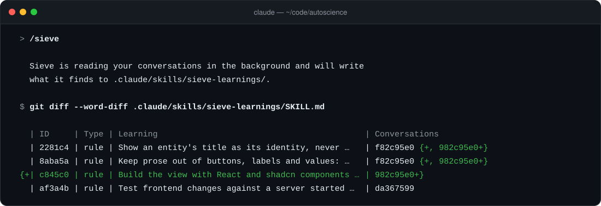

<picture>
  <source media="(prefers-color-scheme: dark)" srcset="./assets/sieve-logo-dark.svg">
  
</picture>

[](./LICENSE)
[](https://code.claude.com/docs/en/plugins)
[](./.claude-plugin/plugin.json)

Sieve reads your past Claude Code conversations about a repository, keeps the few lessons worth sharing, and writes them to a skill that every teammate's Claude reads.



## ✨ Highlight features

- **Little, high-quality output:** most conversations produce nothing. A lesson is kept only when it applies beyond the task it came from and a teammate would otherwise repeat the mistake.
- **Rules and insights:** conclusions people reached, such as corrections, conventions and decisions, plus what Claude proved while working, such as an approach that failed and the one that worked.
- **Updates, not just appends:** new findings are compared with what the table already says. A learning gets reworded when a later conversation sharpens it, gains supporting conversations when it comes up again, and is removed when it turns out wrong.
- **Three layers:** Haiku reads the conversations and extracts candidates, Opus compares the candidates with the current table and decides what changes, and a script applies those changes to the table without touching anything else.
- **Out of your way:** Sieve runs in a separate process and asks nothing. You review the result in the git diff, and nothing is committed for you.
- **Conversation record:** a CSV with the date, the person and a one-line summary of each conversation, kept apart from the learnings.
- **Reads each conversation once:** Sieve remembers where it stopped in every conversation. A conversation that continues later is read from where it stopped.
- **Cheap to run:** tool output, file dumps and screenshots are dropped before any model reads anything, which is usually over 99% of a transcript. Haiku reads the bulk in parallel; Opus only sees the short list of candidates.
- **Runs on its own if you want:** with `/sieve --attach`, it checks for unread conversations every time you open Claude Code in the repo.

## ⚡️ Quickstart

Requires [Claude Code](https://code.claude.com) and Python 3.

#### Install

In Claude Code, run:

```
/plugin marketplace add remark-so/sieve
/plugin install sieve@sieve
```

#### Run

Open Claude Code in any repository and run:

```
/sieve
```

Sieve starts a separate Claude process and gives your conversation back right away; none of its work shows up in your session. It reads the conversations you have had about that repository, including ones you started in a folder above it that edited files in it, and writes what it found to `.claude/skills/sieve-learnings/`. Review the diff and commit, and your team's Claude reads them from then on.

## 📊 See what it learned

```
/sieve --show
```

Opens a page in your browser with the repository's learnings, which you can search and filter by rules and insights, and the record of conversations Sieve has read.

## 🔁 Run it automatically

```
/sieve --attach
```

Every time you open Claude Code in the repository, Sieve reads the conversations it has not read yet in the background and writes what it finds. A single line at the top of the terminal shows what it is doing:

```
Sieve · reading 3 past conversations in the background
Sieve · added 3 learnings to .claude/skills/sieve-learnings
```

Only you see that line; Claude does not, so your conversation is not affected. `/sieve --status` shows what is pending, and `/sieve --detach` turns it off.

## 📁 What it writes

Two files in your repository, both with one row per line, so teammates' changes merge cleanly in git:

| File | What's in it |
|---|---|
| `.claude/skills/sieve-learnings/SKILL.md` | A table of rules and insights. Each row has a fixed id, the reason, the conversations that support it, and when it was added and last updated. Claude Code offers it to Claude at the start of every conversation in the repo. |
| `.claude/sieve/conversations.csv` | The record of conversations: date, id, who had it, and what was worked on. It is data, not something Claude needs to read, so it lives outside the skill. |

## 🔒 What stays on your machine

Your conversations never leave your computer. Sieve writes to the repo only the two files above, and never commits. Which conversations it has read, the condensed text of each run and whether a repo is attached are kept in `~/.claude/sieve/`. Each teammate runs Sieve on their own conversations; the two files above are the shared part.

## 👋 Contribute

Issues and pull requests are welcome. The command lives in [`skills/sieve/SKILL.md`](./skills/sieve/SKILL.md), the reader that goes through each batch in [`agents/reader.md`](./agents/reader.md), and the script that condenses transcripts in [`skills/sieve/scripts/sieve.py`](./skills/sieve/scripts/sieve.py).

## License

MIT
