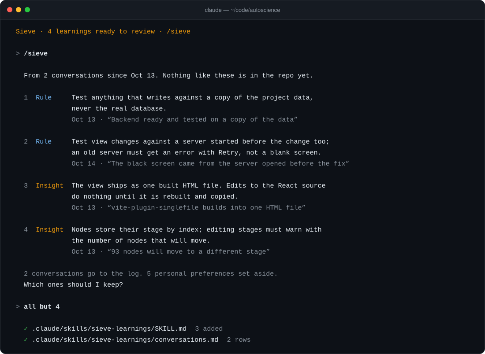

<picture>
  <source media="(prefers-color-scheme: dark)" srcset="./assets/sieve-logo-dark.svg">
  
</picture>

[](./LICENSE)
[](https://code.claude.com/docs/en/plugins)
[](./.claude-plugin/plugin.json)

Sieve reads your past Claude Code conversations about a repository, keeps the few lessons worth sharing, and, once you approve them, writes them to a skill that every teammate's Claude reads.



## ✨ Highlight features

- **Little, high-quality output:** most conversations produce nothing. A lesson is kept only when it applies beyond the task it came from and a teammate would otherwise repeat the mistake.
- **Rules and insights:** conclusions people reached, such as corrections, conventions and decisions, plus what Claude proved while working, such as an approach that failed and the one that worked.
- **You approve everything:** each proposal comes with the quote it came from. Nothing reaches the repo until you pick what to keep, and nothing is committed for you.
- **Conversation log:** a markdown table with the date, the person and a one-line summary of each conversation.
- **Reads each conversation once:** Sieve remembers where it stopped in every conversation. A conversation that continues later is read from where it stopped.
- **Cheap to run:** tool output, file dumps and screenshots are dropped before any model reads anything, which is usually over 99% of a transcript. Batches are read in parallel by Haiku.
- **Runs on its own if you want:** with `/sieve --attach`, it checks for unread conversations every time you open Claude Code in the repo.

## ⚡️ Quickstart

Requires [Claude Code](https://code.claude.com) and Python 3.

#### Install

In Claude Code, run:

```
/plugin marketplace add rodrigosnader/sieve
/plugin install sieve@sieve
```

#### Run

Open Claude Code in any repository and run:

```
/sieve
```

Sieve reads the conversations you have had about that repository, shows what it found, and asks which ones to keep. Commit the files it writes, and your team's Claude reads them from then on.

## 🔁 Run it automatically

```
/sieve --attach
```

Every time you open Claude Code in the repository, Sieve checks in the background for conversations it has not read and prepares its proposals. A single line at the top of the terminal shows what it is doing:

```
Sieve · reading 3 past conversations in the background
Sieve · 4 learnings ready to review · /sieve
```

Only you see that line; Claude does not, so your conversation is not affected. Run `/sieve` to review, `/sieve --status` to see what is pending, and `/sieve --detach` to turn it off.

## 📁 What it writes

Two files in your repository, both plain markdown:

| File | What's in it |
|---|---|
| `.claude/skills/sieve-learnings/SKILL.md` | The approved rules and insights, each with the date it was learned. Claude Code offers it to Claude at the start of every conversation in the repo. |
| `.claude/skills/sieve-learnings/conversations.md` | One row per conversation: date, id, who had it, and what was worked on. |

## 🔒 What stays on your machine

Your conversations never leave your computer, and Sieve only writes to the repo what you approve. Which conversations it has read, the condensed text of each run and whether a repo is attached are kept in `~/.claude/sieve/`. Each teammate runs Sieve on their own conversations; the two files above are the shared part.

## 👋 Contribute

Issues and pull requests are welcome. The command lives in [`skills/sieve/SKILL.md`](./skills/sieve/SKILL.md), the reader that goes through each batch in [`agents/reader.md`](./agents/reader.md), and the script that condenses transcripts in [`skills/sieve/scripts/sieve.py`](./skills/sieve/scripts/sieve.py).

## License

MIT
